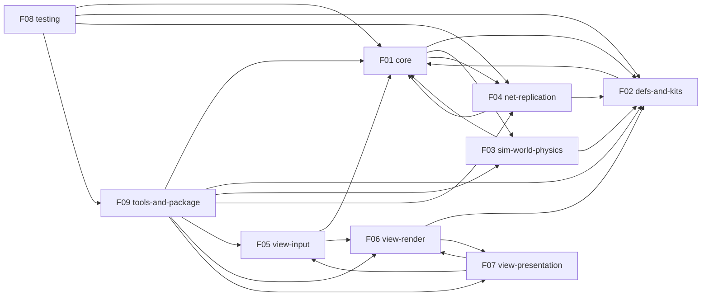

# As-built specifications

These specs describe what the Lion Hawk engine code does at the source commit, not what anyone intended. Each behavior statement (`B-n`) carries `path:line` evidence from the code or its tests. A change spec cites the `B-n` it changes. The specs come from the code, tests and docs only.

Written in STE style (ASD-STE100-inspired). Not certified compliant.

Source commit: `7224d6b`; F02 and F07 were rerun at `4cd5a94`. F09 gained "Bake: levels of detail" (B-239 to B-246, [A-12]), view-presentation "Level of detail" (B-215 to B-221) and view-render B-245 to B-248 (`LOD_FADE`, the eye) by hand.

| ID | Feature | Summary | Spec |
| --- | --- | --- | --- |
| F01 | Engine core | Fixed-step engine, loop, scheduling, actions, events, players, controllers, UI and menu navigation model, RNG and math helpers. | [core.md](core.md) |
| F02 | Definitions and kits | Material registry, physics sidecar schema and net fields, plus the vehicle kit (raycast and tire backends, the powertrain, and the engine sound view half), terrain, coverage, fx and glyph kits. | [defs-and-kits.md](defs-and-kits.md) |
| F03 | Simulation world, physics and fields | Entity world, transform pool and placement, Rapier physics backend, colliders, collision groups, events, heightfields, and the phase 8 fields: wind, aero, buoyancy and magnetism. | [sim-world-physics.md](sim-world-physics.md) |
| F04 | Networking and replication | Transports, ports, peer keys, bridge, replica codec, wire schema and limits, interpolation and forecast, install, remote entities and replication. | [net-replication.md](net-replication.md) |
| F05 | View boot, input and seats | Browser boot and driver, debug hook, keyboard, gamepad, touch, pointer and gestures, mapping contexts and profiles, local seats, haptics, DOM UI, menu navigation and the pad bench. | [view-input.md](view-input.md) |
| F06 | Rendering and materials | Render pipeline, looks, lights, GPU hygiene, and the view material compiler with shader features. | [view-render.md](view-render.md) |
| F07 | View sync, camera, assets and audio | Syncs sim entities to three.js objects, instancing and crowds, camera rigs, asset loading and animation tables, and audio: buses, voices, cues, contact sounds and the DSP host. | [view-presentation.md](view-presentation.md) |
| F08 | Test helpers | The lion-hawk/test and lion-hawk/playwright helpers: headless harness, checks, invariants, golden state, record and replay, multiplayer harness and Playwright driver. | [testing.md](testing.md) |
| F09 | CLI, tools and package surface | The lion-hawk CLI: bake, build, dev server and glyph build, plus the package entry points and exports. | [tools-and-package.md](tools-and-package.md) |

## Dependencies

An arrow points from a feature to a feature it imports.

Write order (dependencies first): F02 → F01 → F03 → F04 → F05 → F07 → F06 → F09 → F08.

## Reference

- [Glossary](_meta/glossary.md): one term per concept, used by every spec.
- [Discrepancies](_meta/discrepancies.md): places where docs disagree with the code.
- [Coverage](_meta/coverage.md): files per feature, exclusions, remaining issues and open questions.
- [Feature map](_meta/features.json) and [inventory](_meta/inventory.json).

## Updating

When a change alters behavior, update the specs in the same commit:

- Edit the `B-n` statements that no longer hold. Add a statement with the next free number in that spec for a new behavior, and delete a statement for a removed one. Don't renumber the others: change specs and commits cite them.
- Give every statement `path:line` evidence from the code or a test, in brackets at its end. When your change moves lines in a file that a spec cites, fix those references too: `git grep -n '<file>:'` over `docs/specs/as-built/` finds them.
- Use the terms in the [glossary](_meta/glossary.md), and write short, plain sentences, one fact each, like the statements around yours.

The maintainers regenerate whole specs now and then with private tooling, which updates `source_commit` in each spec's front matter. Contributors don't need to.
